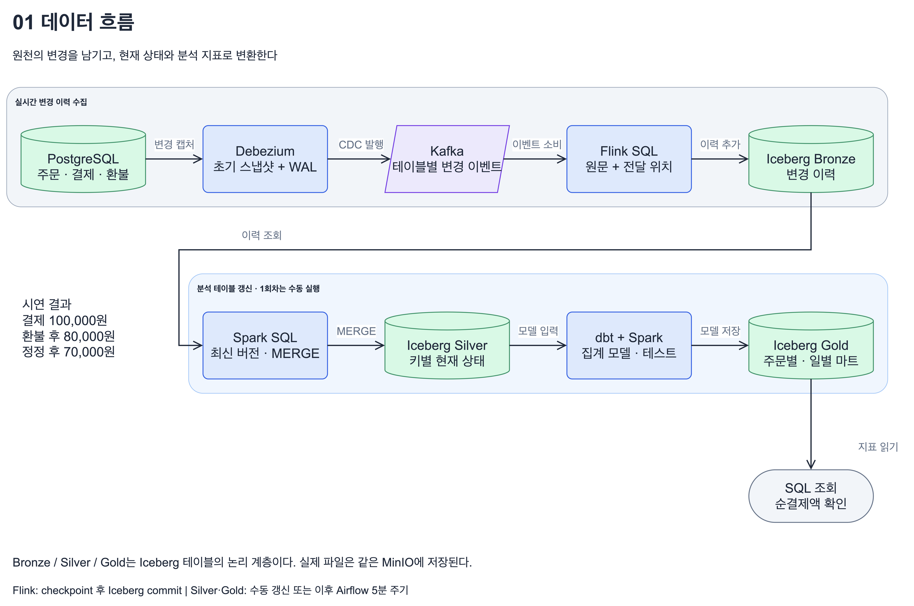
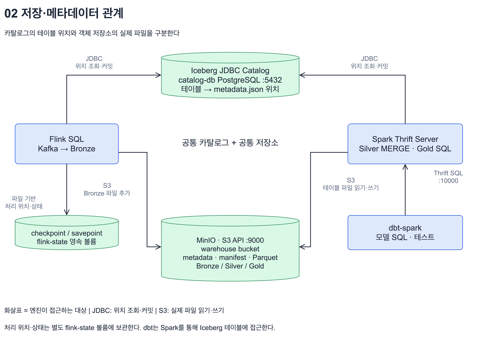
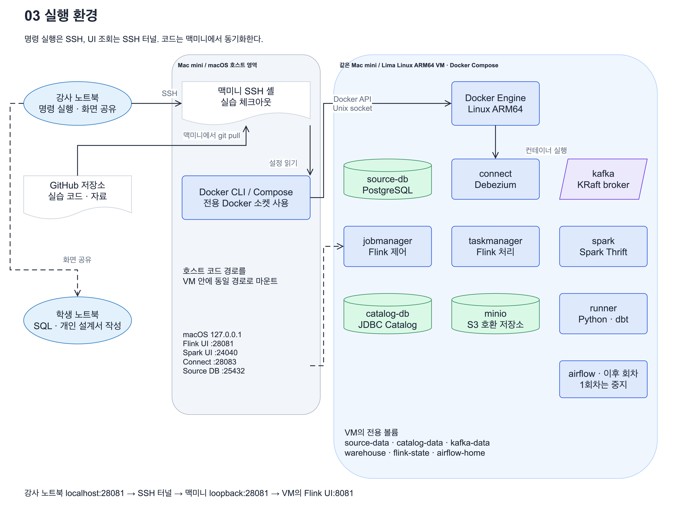
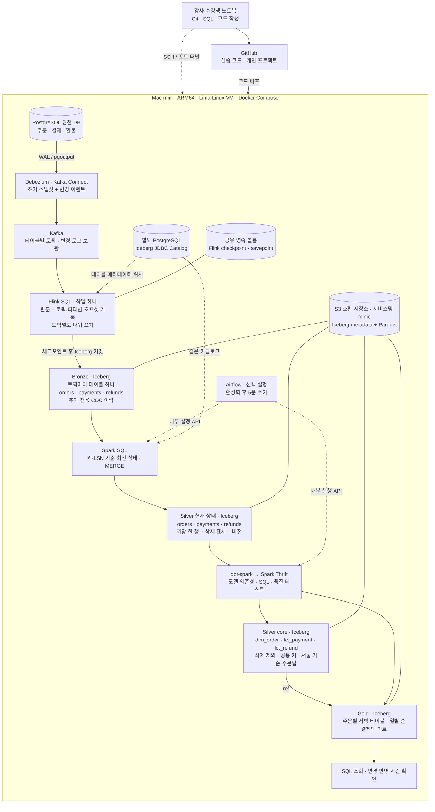

# 전체 아키텍처

같은 프로젝트를 세 가지 관점으로 나눠 그렸다. [그림 설명과 편집 원본](diagrams/README.md)을 함께 제공한다.

### 데이터 흐름

### 저장·메타데이터 관계

### 실행 환경

## 각 계층에서 배우는 것

| 계층 | 저장하는 내용 | 확인할 질문 |
|---|---|---|
| PostgreSQL | 서비스의 현재 트랜잭션 상태 | 어떤 키가 한 건을 식별하는가? |
| Kafka | INSERT/UPDATE/DELETE 이벤트 | 어느 토픽·파티션·오프셋까지 전달됐는가? |
| Bronze | 원문 CDC와 전달 메타데이터, 토픽마다 테이블 하나 | 수정 전후와 삭제 사건을 다시 읽을 수 있는가? |
| Silver 현재 상태 | 키별 최신 상태, 삭제 표시, LSN (원천 테이블 구조 그대로) | 과거 이벤트가 다시 와도 현재 상태가 되돌아가지 않는가? |
| Silver core | 가장 작은 입도의 공통 fact·dim(`dim_order`, `fct_payment`, `fct_refund`), 삭제 제외, 공통 키, 서울 기준 주문일 | 여러 마트가 같은 기준의 주문·결제·환불을 읽는가? |
| Gold | 소비자용 서빙 테이블과 집계 마트(주문일 기준 순결제액) | 환불 수정·삭제 후 기대한 금액과 일치하는가? |

**실시간 적재와 마트 갱신은 서로 다른 주기다.** Flink의 체크포인트 간격은 기본 10초이고, Iceberg에서 조회 가능한 시점은 실제 커밋 완료 이후다. 기본 환경에서 새 변경을 Gold로 자동 갱신하는 주기 작업은 실행하지 않는다. 수동으로 변환을 실행하거나, 개인 실행 도우미의 `--with-marts`를 선택하면 이번 사건의 Silver·Gold를 갱신한다.

Airflow는 `orchestration` 선택 프로필이다. 이를 기동하고 최초 일시정지 상태인 `lakehouse_refresh` DAG를 활성화한 뒤에 기본 5분 스케줄을 적용한다. 최종 반영에는 Spark SQL·dbt 실행 시간도 더해지므로 Bronze 조회와 최종 지표의 지연을 별도로 측정한다. 목표 지연은 각 프로젝트에서 정한다. [기동과 활성화 방법](operations.md#후속-회차--airflow)을 참고한다.

## 선택한 구성의 이유와 경계

- Kafka와 Spark는 정규 과정에서 배운 기술을 활용한다. 새로운 학습의 중심은 CDC 해석, Iceberg 테이블, 변경 반영, dbt 모델링과 검증이다.
- Bronze는 원문을 남긴다. 이 실습은 Flink가 Iceberg에 현재 상태를 직접 upsert하는 구조가 아니다. 현재 상태를 만드는 책임은 Spark SQL에 있다.
- Bronze는 Kafka 토픽마다 Iceberg 테이블 하나다(`lake.bronze.orders`·`lake.bronze.payments`·`lake.bronze.refunds`). Flink 작업 `cdc-bronze` 하나가 세 토픽을 한 번 읽고 `topic` 값으로 나눠 쓴다. 출처 확인용 `topic` 열은 그대로 둔다. Silver는 원천 테이블과 같은 이름의 Bronze 테이블 하나만 읽는다. 작업은 Kafka 그룹이 commit한 offset(`group-offsets`)에서 시작하고, 그룹 위치가 없으면 가장 이른 offset부터 읽는다.
- 2026-11-01 이전에 만든 환경은 세 토픽을 한 테이블(`lake.bronze.cdc_events`)에 모았다. 그 시기의 출력에 보이는 `cdc_events`는 이전 구성의 결과이며, 기존 환경의 전환 절차는 [환경 운영 안내](operations.md#bronze-토픽별-테이블-전환-기존-환경-1회)에 있다. 위 PNG 그림은 Bronze를 상자 하나로 그린 개념도이며 테이블 구성까지 나타내지 않는다.
- JDBC Catalog와 MinIO는 ARM 맥미니 한 대에서 실행할 수 있는 구성이다. 실제 S3로 옮길 때는 엔드포인트·IAM·네트워크 설정을 바꿔야 한다.
- Spark SQL과 dbt는 같은 Spark Thrift Server와 Iceberg 카탈로그를 사용한다. dbt 자체가 연산 엔진은 아니다.
- fact·dim은 Silver에 둔다. Silver는 두 단계다. 1단계는 Spark SQL MERGE가 만드는 현재 상태 테이블(원천 구조, 키당 한 행, 삭제 표시)이고, 2단계 Silver core는 dbt가 그 위에 만드는 공통 fact·dim이다. Gold는 소비자에게 맞춘 서빙 테이블과 집계 마트만 둔다. Databricks 메달리온 문서는 dimensional model을 Gold에서 만든다고 설명하지만, 이 과정은 여러 마트가 같은 기준을 다시 쓰도록 공통 fact·dim을 Silver에 둔다. Silver core 모델은 `dim_`·`fct_`, Gold 모델은 `mart_`로 이름을 시작한다. 주문 단위 Gold 테이블은 2026-11-01에 `fct_order_settlement`에서 `mart_order_settlement`로 이름을 바꿨다. 그 전에 기록한 출력의 `fct_order_settlement`는 같은 역할의 이전 이름이다.
- dbt의 `models/silver/` 모델은 `silver` 스키마에 만든다. 기본 규칙이면 `gold_silver`가 되므로 `macros/generate_schema_name.sql`이 지정한 스키마 이름을 그대로 쓴다.
- 기준 구현은 Bronze 전체 조회 → Silver MERGE → Silver core·Gold 전체 재생성이다. 먼저 결과의 정확성을 확보한 뒤 증분 범위와 마트 갱신 주기를 개선한다.
- 토픽당 파티션 하나, 원천 DB 하나를 전제로 LSN과 오프셋으로 순서를 판별한다. 토픽 재생성, DB 복원, 다중 파티션 확장은 별도 설계가 필요하다.
- 단일 노드 수업 환경이다. TaskManager 복구를 실습하며, Mac mini나 JobManager 전체 장애에 대한 HA를 제공하지 않는다. checkpoint 볼륨을 삭제하거나 Kafka 보관 기간이 지나면 복구 조건이 달라진다.

그림의 MinIO는 S3 호환 저장소 역할을 가리킨다. 현재 Compose는 MinIO의 커뮤니티 포크인 SILO 이미지를 사용하며, 서비스 이름과 내부 주소는 `minio`·`http://minio:9000`으로 유지한다. 이번 기존 맥미니 환경의 실행 확인은 이전 MinIO 이미지에서 진행했다. 새 설치 이미지와 기존 데이터의 이전은 [환경 운영 안내](operations.md)를 구분해 확인한다.

## 코드와 실행 환경

노트북에서는 코드를 작성하고 GitHub에 올린다. 컨테이너와 데이터는 맥미니에서 실행한다. UI는 SSH 터널로 접속하며 외부에 공개하지 않는다. 원천 DB·Kafka·객체 저장소·카탈로그·체크포인트는 각각 전용 볼륨을 사용한다.

여러 원천 테이블을 하나의 트랜잭션으로 동시에 갱신하는 경우, 이 기준 구현은 테이블 간 동일 트랜잭션 시점의 스냅샷을 보장하지 않는다. Bronze가 따라잡은 뒤 최종 결과가 수렴하는 것을 검증한다. 거래 단위의 즉시 일관성이 필요한 도메인은 트랜잭션 경계·완료 신호와 일관된 처리 범위를 추가로 설계한다.
