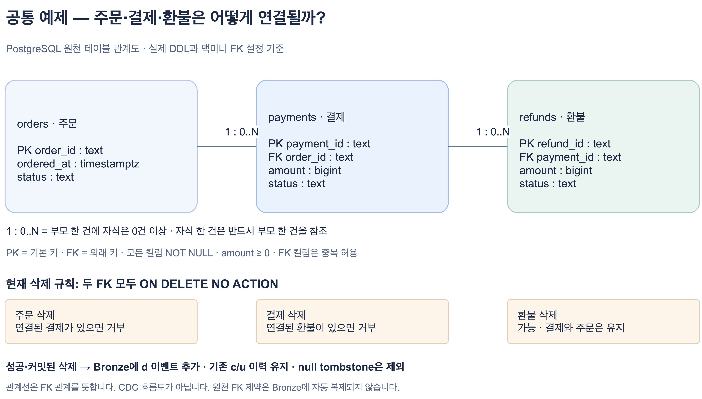

# 공통 예제의 테이블 관계와 삭제 동작

[관계도 편집 원본](diagrams/04-common-example-erd.drawio) · [실제 원천 DDL](../sql/01-source.sql)

## 무엇을 연결한 예제인가요?

`payments.order_id`는 `orders.order_id`를, `refunds.payment_id`는 `payments.payment_id`를 참조합니다. 두 FK는 `NOT NULL`이며 `UNIQUE`는 아닙니다. 따라서 주문 한 건에 결제는 **0건 이상**, 결제 한 건에 환불은 **0건 이상** 연결할 수 있습니다. 결제나 환불 한 건은 각각 부모 한 건을 반드시 참조합니다.

수업에서 결제·환불 한 건으로 관찰해도 테이블 관계가 1:1인 것은 아닙니다. 실제 결제 업무의 모든 규칙을 구현한 모델이 아니라 CDC 수집을 이해하기 위한 합성 예제입니다. `amount >= 0`은 각 행의 음수를 막는 조건이며, 환불 합계가 결제 금액을 넘지 않는다는 업무 규칙까지 검증하지는 않습니다.

## FK로 연결된 행을 삭제하면 어떻게 되나요?

현재 두 FK는 **`ON DELETE NO ACTION`, `NOT DEFERRABLE`**입니다. DDL에서 `ON DELETE`를 생략했기 때문에 기본 동작인 `NO ACTION`이 적용됩니다. 맥미니 원천 DB의 실제 제약도 같은 설정입니다.

| 삭제하려는 행 | 현재 예제의 결과 |
| --- | --- |
| 연결된 결제가 있는 주문 | FK 위반으로 삭제 실패 |
| 연결된 환불이 있는 결제 | FK 위반으로 삭제 실패 |
| 환불 | 삭제 가능. 해당 결제와 주문은 유지 |
| 연결된 자식이 없는 주문·결제 | 삭제 가능 |

즉, **주문을 지운다고 결제·환불이 자동으로 지워지지 않습니다.** 둘 다 지워야 하는 요구가 있다면 환불 → 결제 → 주문 순서로 필요한 행을 명시적으로 처리하고 트랜잭션 경계를 설계해야 합니다. 이는 원천 DB의 삭제 정책을 설명한 것이며, 현재 공통 예제 데이터를 추가로 삭제하라는 실습 지시는 아닙니다.

참조 중인 부모 삭제를 거부하는 기본 동작과 `CASCADE`·`SET NULL`의 차이는 [PostgreSQL FK 공식 문서](https://www.postgresql.org/docs/17/ddl-constraints.html#DDL-CONSTRAINTS-FK)에서 확인할 수 있습니다.

## 그 삭제는 Kafka와 Bronze에서 어떻게 보이나요?

**FK 오류로 실패한 삭제**에는 성공·커밋된 행 삭제가 없으므로, 그 실패에 해당하는 CDC `d` 이벤트도 생기지 않습니다. 다른 트랜잭션에서 발생한 이벤트와 구분해야 합니다.

반대로 **환불 삭제가 성공하고 커밋되면** 현재 설정에서 다음과 같이 보입니다.

1. 원천 PostgreSQL: 해당 환불 행이 사라집니다. 결제와 주문 행은 남습니다.
2. Kafka `cdc.public.refunds`: `op = d`, `before = 삭제 전 행`, `after = null`인 이벤트가 생성됩니다. 현재 예제는 `REPLICA IDENTITY FULL`이므로 삭제 전 금액·상태도 확인할 수 있습니다. 다른 환경에서 `before`가 언제나 전체 컬럼을 담는다고 일반화하지 않습니다.
3. Kafka: 같은 키에 **value가 null인 별도의 tombstone**이 뒤따릅니다. 현재 Debezium의 `tombstones.on.delete`는 `true`입니다. `after = null`인 삭제 이벤트와 메시지 value 자체가 null인 tombstone은 다릅니다. [Debezium 공식 문서](https://debezium.io/documentation/reference/3.0/connectors/postgresql.html#postgresql-delete-events)
4. Bronze `lake.bronze.cdc_events`: 현재 [Flink SQL](../flink/ingest.sql.template)은 원문을 추가하는 방식입니다. 기존 `c`·`u` 이력은 유지되고 **`d` 이벤트가 한 행 추가**됩니다. null tombstone은 `WHERE payload IS NOT NULL`에서 제외됩니다. 삭제 후에도 기존 이벤트를 그대로 `COUNT`하거나 금액을 단순 합산하면 현재 환불 건수·금액이 되지 않습니다.

**원천 테이블의 현재 상태와 Bronze의 변경 이력은 다른 결과를 보여주는 것이 정상입니다.** 키별 최신 상태를 판별하고 삭제를 적용하는 Silver, 그 상태로 지표를 다시 계산하는 Gold는 후속 처리로 설계합니다.

## 다른 삭제 정책을 선택한다면?

| 정책 | 부모 행을 삭제할 때 | 현재 예제와의 차이 |
| --- | --- | --- |
| `NO ACTION` | 검사 시 참조 행이 남아 있으면 오류 | 현재 설정. 두 FK 모두 지연 검사 불가 |
| `CASCADE` | 해당 FK로 참조하는 자식 행도 삭제 | 현재는 미설정. 주문에서 환불까지 연쇄 삭제하려면 두 관계의 정책 모두 고려 |
| `SET NULL` | 자식의 FK 컬럼을 null로 변경 | 현재 FK는 `NOT NULL`이므로 그대로 적용하면 실패. nullable 관계로 설계 변경 필요 |

`NO ACTION`과 `RESTRICT`를 완전히 같은 옵션으로 설명하지 않습니다. `NO ACTION`은 제약을 `DEFERRABLE`로 선언하면 검사를 지연할 수 있지만, 현재 예제는 `NOT DEFERRABLE`입니다.

원천에 `CASCADE`를 설정해 부모·자식이 실제로 삭제되고 그 테이블이 수집 대상이라면, Debezium은 각 행의 삭제를 이벤트로 전달합니다. **Bronze가 FK를 해석해서 자식을 삭제하는 것은 아닙니다.** 현재 원문 추가 구조에서는 그 개별 삭제 이벤트가 이력으로 쌓입니다.

원천 DB의 FK는 비동기 파이프라인 전체의 조회 정합성까지 보장하지 않습니다. 테이블별 Kafka 토픽을 합쳐 읽을 때 토픽 간 도착 순서는 보장되지 않으므로, 잠시 자식 이벤트가 부모보다 먼저 보일 수도 있습니다. 참조 관계 검증과 여러 테이블을 어떤 시점 기준으로 조회할지도 별도로 설계해야 합니다.

수업의 `DELETE`는 CDC 동작을 이해하기 위한 예입니다. 실제 결제 취소를 물리 삭제로 처리하라는 뜻은 아니며, 상태 변경·반대 거래·이력 보존 요구에 따라 업무 모델을 정해야 합니다.
