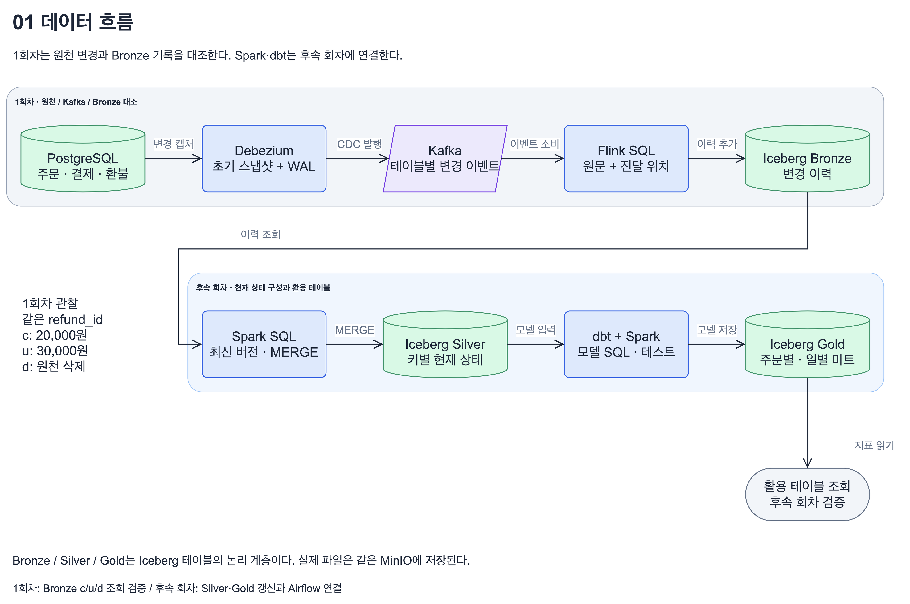
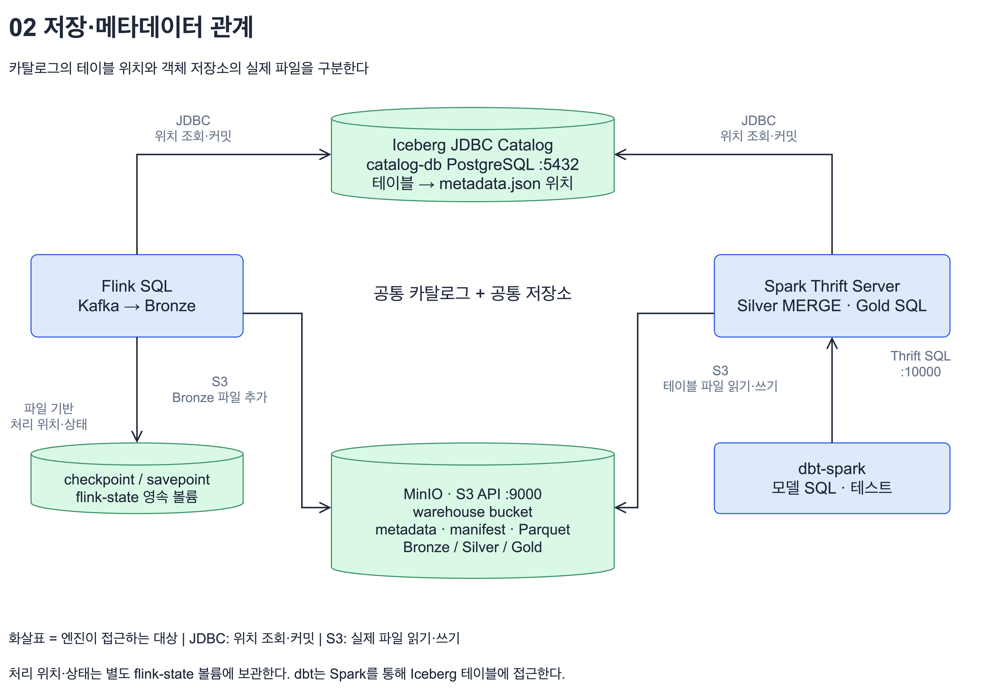
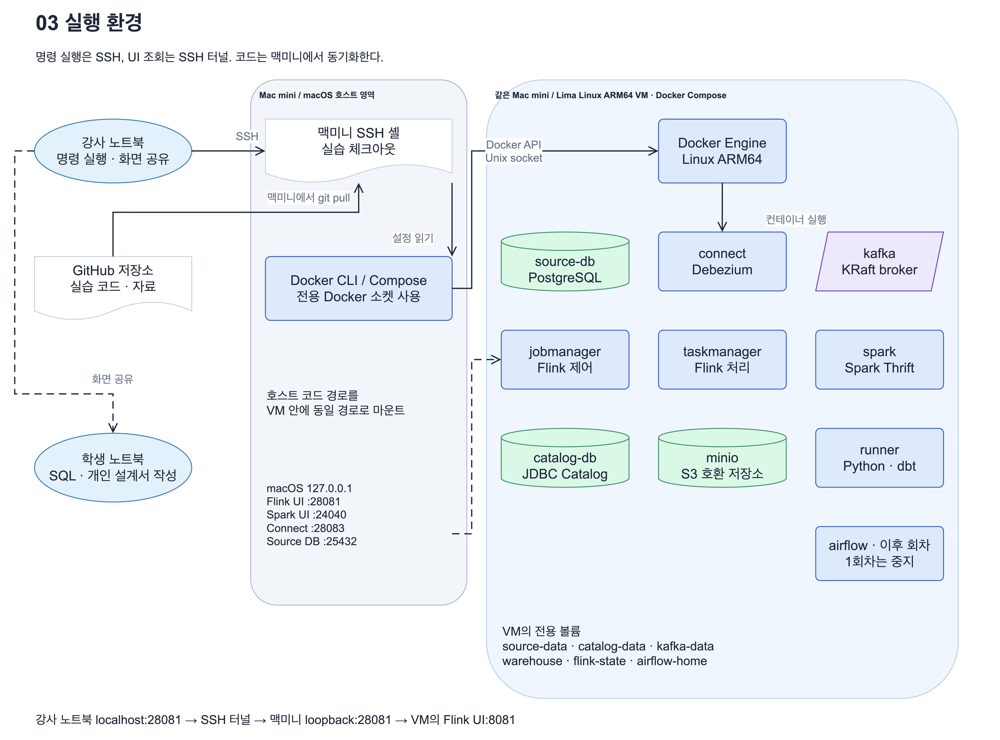

# 프로젝트 아키텍처 — 세 가지 관점

같은 시스템을 데이터 흐름, 저장·메타데이터 관계, 실행 환경으로 나눠 설명한다. PNG는 강의 화면에 사용하고 `.drawio`는 draw.io Desktop 또는 diagrams.net에서 도형·연결선·텍스트를 수정하는 원본으로 사용한다.

## 01. 데이터 흐름

[편집 원본](01-data-flow.drawio)

PostgreSQL 변경을 Debezium이 캡처하고 Kafka에 전달한다. Flink는 원문과 전달 위치를 Bronze에 추가한다. Spark SQL은 키별 최신 버전을 판별해 Silver를 만들고, dbt 모델을 같은 Spark에서 실행해 Gold를 갱신한다.

Bronze·Silver·Gold는 논리적인 Iceberg 테이블 계층이다. 서로 다른 저장 서버 세 대를 뜻하지 않는다. 1회차는 같은 refund_id의 c/u/d 이력 보관을 확인하며 Silver·Gold는 후속 회차다.

## 02. 저장·메타데이터 관계

[편집 원본](02-storage-metadata.drawio)

Flink와 Spark가 같은 JDBC Catalog와 MinIO를 사용한다. Catalog는 테이블의 metadata.json 위치를 관리한다. 실제 metadata, manifest와 Parquet 파일은 MinIO의 warehouse bucket에 저장된다. JDBC 요청과 S3 파일 접근을 각각 표시했다.

화살표는 엔진이 접근하는 대상을 가리킨다. 조회 응답이나 모든 파일의 이동 방향을 뜻하지 않는다. Flink의 checkpoint·savepoint는 별도 flink-state 볼륨에 저장된다. dbt는 Thrift SQL로 Spark에 실행을 요청한다.

## 03. 실행 환경

[편집 원본](03-runtime.drawio)

한 대의 맥미니에서 macOS 호스트 영역과 Lima Linux VM 영역을 구분했다. 호스트에는 실습 체크아웃과 Docker CLI가 있고, 컨테이너와 전용 볼륨은 VM에서 사용한다. 호스트 코드 경로는 VM 안에 동일한 경로로 마운트한다.

강사가 SSH로 맥미니에 접속해 화면을 공유한다. 학생은 자기 노트북에서 SQL·개인 프로젝트 설계서를 작성한다. Airflow는 이후 회차의 주기 실행에 사용하며, 1회차에서는 Bronze까지 수집을 대조한다. UI는 SSH 로컬 터널과 맥미니 loopback의 Lima 포트 전달 경로로 조회한다. minio-init처럼 초기화만 하는 일회성 컨테이너는 주요 배치도에서 생략했다.

## 작성 기준과 검증

`compose.yaml`, `flink/ingest.sql.template`, `spark/start-thrift.sh`, `scripts/pipeline.py`, `scripts/runner_api.py`, `airflow/dags/lakehouse_refresh.py`를 읽고 구성에 맞춰 작성했다. 그림은 설정과 수업 진행 방식에 따른 구조를 표현한다.

[검증 기록](verification.md). drawio 스킬의 YAML 기반 작성·검증·Desktop PNG 내보내기 절차를 사용했다. 편집 원본에는 실제 source/target에 연결된 도형과 연결선이 들어 있으며, 전체 페이지를 한 장의 이미지로 붙인 파일이 아니다.

재생성에 사용하는 YAML 명세도 [specs](specs/)에 보관합니다.
