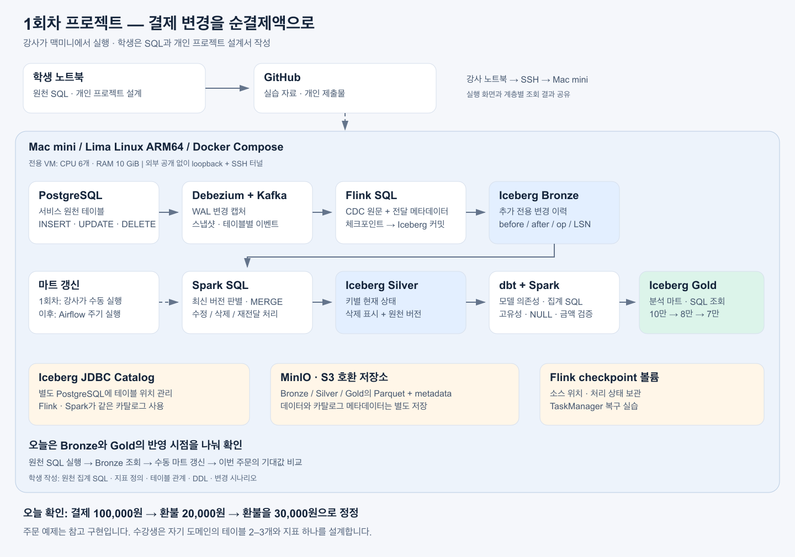

# 1회차 — 결제 한 건이 분석 지표가 되기까지

**2시간 · 온라인 · 강사 맥미니 시연 + 학생 SQL·설계서 작성**

Kafka와 Spark를 연결한 전체 흐름을 먼저 눈으로 확인한다. 100,000원 결제에 환불이 들어왔을 때 원천 DB, 변경 이력, 현재 상태와 분석 지표가 어떻게 달라지는지 따라간다. 이후 각자 만들 프로젝트의 지표와 원천 테이블을 설계한다.

- [강사용 120분 진행안](instructor-guide.md)
- [학생용 실습 가이드](student-guide.md)
- [프로젝트 아키텍처와 예제 모델](architecture.md)
- [학생 제출 템플릿](submission-template.md)
- [강사용 실행 순서와 장애 대응](runbook.md)
- [2026-10-14 리허설 결과](rehearsal.md)

## 끝날 때 남는 것

1. 결제·환불·환불 정정의 예상값과 실제값 비교 기록.
2. 내가 선택한 프로젝트 주제, 지표 하나, 기준 시각과 허용 지연.
3. 원천 테이블 2–3개의 관계 초안과 테이블 하나의 DDL.
4. 수정·삭제가 지표에 미치는 영향을 설명하는 시나리오.

실행 파일 `lab.sh`와 `observe.py`는 강사가 맥미니에서 사용한다. 학생은 자기 노트북에서 SQL과 문서를 작성하며, 이 수업에서 Docker·Flink 클러스터 설치를 진행하지 않는다. 개인 프로젝트 구현은 다음 회차부터 단계별로 확장한다.
