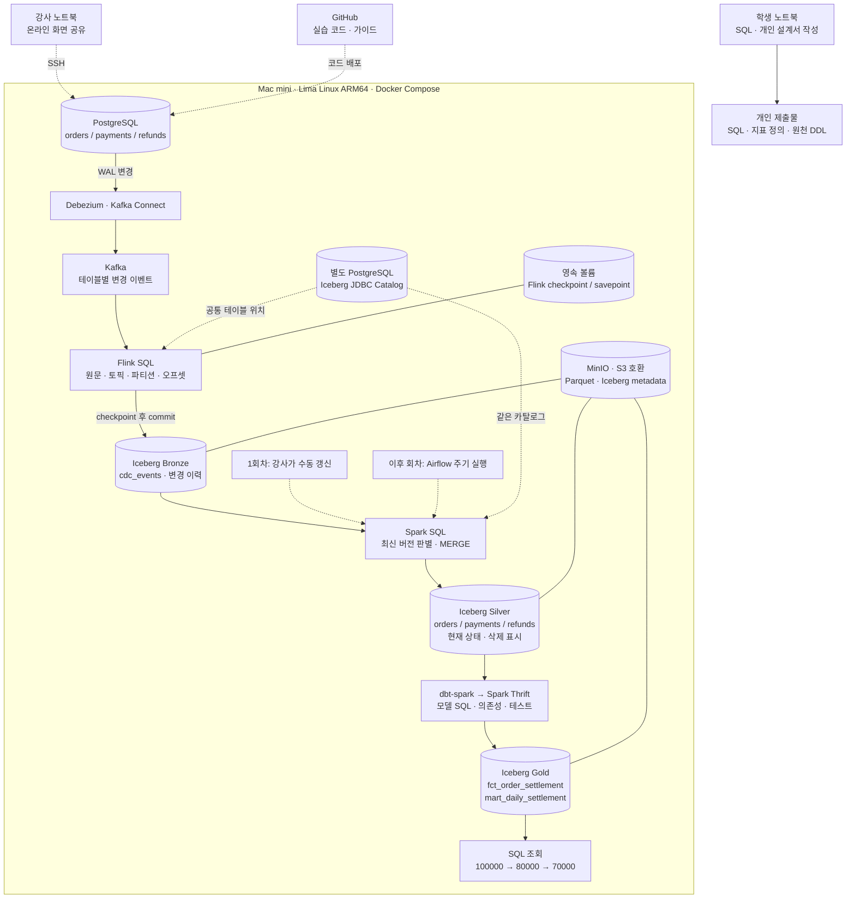
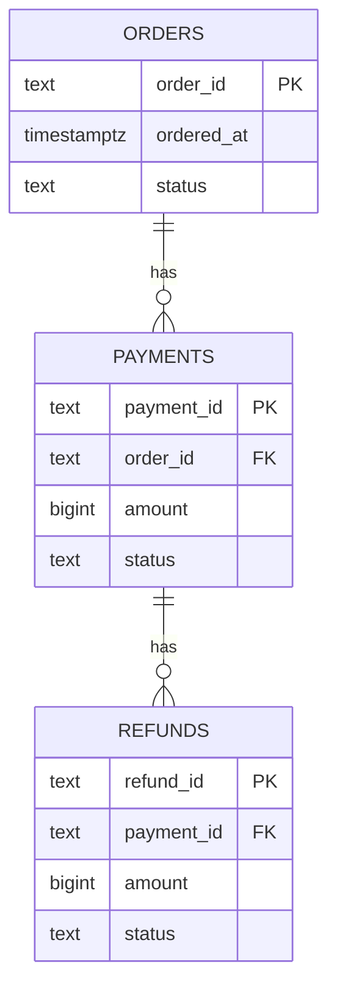
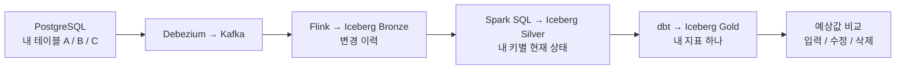

# 1회차 프로젝트 아키텍처

## 전체 데이터 흐름

1회차에는 미리 구성한 파이프라인에서 입력과 조회 결과를 연결한다. 새로운 SQL의 실행은 강사가 맡고, 학생은 예상값 계산·원천 SQL·개인 프로젝트 설계를 수행한다. Airflow 자동 갱신은 멈춰두고 변경 전후를 수동으로 비교한다.

## 예제 원천 모델

주문 1건 : 결제 N건, 결제 1건 : 환불 N건이다. 오늘 시연은 결제·환불 각각 한 건으로 시작하되, 학생이 작성하는 집계 SQL은 여러 건도 중복 합산 없이 처리하도록 설계한다.

## 모델별 의미

| 모델 | 남기는 내용 | 오늘 확인하는 값 |
|---|---|---|
| Bronze `cdc_events` | before/after/op와 전달 위치를 가진 변경 이력 | 환불 입력 c, 금액 정정 u |
| Silver `refunds` | 환불 키별 최신 금액·삭제 표시·원천 버전 | 같은 refund_id 한 행, amount=30000 |
| Gold `fct_order_settlement` | 주문별 결제 성공액·환불 성공액·순결제액 | net_paid=70000 |
| Gold `mart_daily_settlement` | 주문일별 주문 수와 금액 합계 | 다른 시연 데이터도 함께 합산되므로 별도 해석 필요 |

교실의 기대값 검증은 `fct_order_settlement`의 **이번 시연 order_id 한 건**으로 한다. 전체 일별 마트는 이전 리허설 주문까지 포함하므로 항상 70,000원이라고 가정하지 않는다.

Flink는 Bronze에 추가 전용 이력을 저장한다. Silver의 현재 상태는 Spark SQL이 만들며, dbt는 Gold 모델을 Spark에서 실행하고 테스트한다. 객체 파일과 카탈로그 DB는 함께 테이블을 구성한다. 실시간 수집과 마트 갱신의 지연은 별도로 확인한다.

## 개인 프로젝트 작성 틀

아래 그림을 복사해 원천 테이블과 지표를 자신의 도메인에 맞게 바꾼다. 첫 회차에는 지표 하나와 테이블 2–3개로 범위를 잡는다.

그림 아래에는 다음을 적는다.

- 지표를 볼 사용자와 의사결정.
- 집계 단위·계산식·기준 날짜·시간대.
- 각 테이블에서 한 행의 의미와 PK/FK.
- 어떤 수정·삭제가 어떤 지표를 바꾸는가.
- 원천 변경부터 Gold까지 허용하는 지연과 이유.
- 아직 구현하지 않은 설정과 다음 회차에 확인할 부분.

예약·물류·구독 등 각자의 주제를 선택한다. 이번 주문 예제의 SQL을 실행해 본 경험을 자신의 데이터 모델에 적용하는 것이 개인 프로젝트의 출발점이다.
