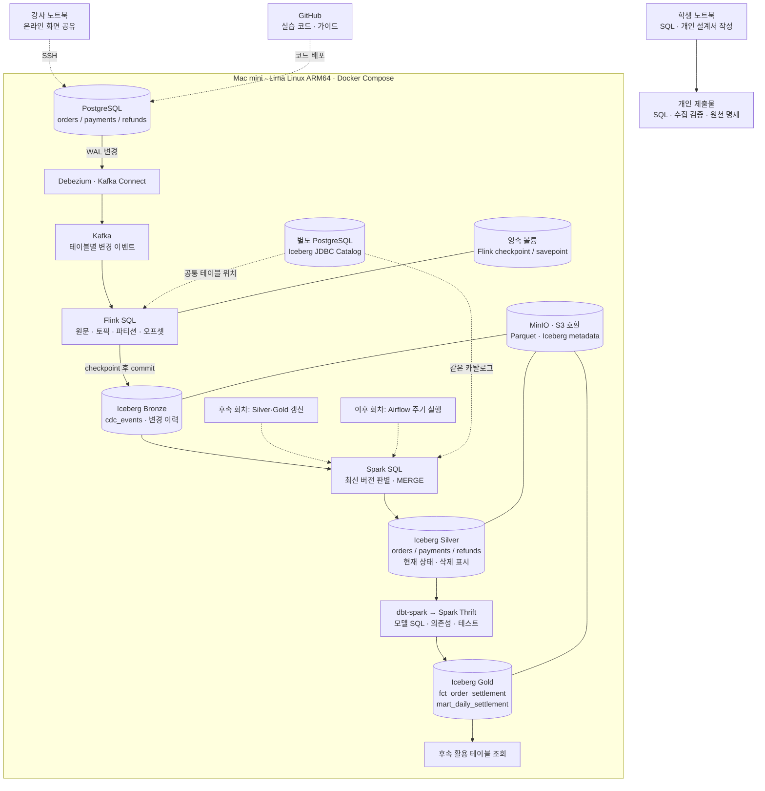
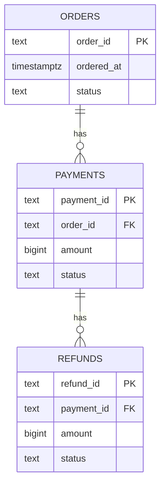
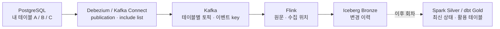

# 1회차 프로젝트 아키텍처

## 데이터 흐름

## 저장·메타데이터 관계

## 실행 환경

[그림 설명과 편집 가능한 draw.io 원본](../../docs/diagrams/README.md)

## 전체 데이터 흐름

1회차에는 미리 구성한 수집 경로에서 원천 INSERT·UPDATE·DELETE와 Kafka·Bronze 이벤트를 대조한다. 실행은 강사가 맡고 학생은 기대 이벤트·원천 확인 SQL·개인 파이프라인 설계를 작성한다. Airflow는 중지하며 Silver·Gold는 후속 회차의 역할만 설명한다. 그림은 1회차 Bronze 검증과 후속 Silver·Gold를 구분한다.

## 예제 원천 모델

주문 1건 : 결제 N건, 결제 1건 : 환불 N건이다. 오늘은 주문·결제를 준비한 뒤 같은 refund_id의 입력·정정·삭제를 관찰한다. 원천 행 수와 Bronze 이력 행 수를 구분한다.

## 계층별 역할과 오늘의 범위

| 계층 | 저장 내용 | 이번 회차 |
|---|---|---|
| Bronze cdc_events | CDC 원문과 topic/partition/offset | c/u/d와 동일 수집 위치·내용 검증 |
| Silver | 키별 최신 상태·삭제 표시·원천 버전 | 역할 설명, 구현·검증은 후속 회차 |
| Gold | 활용 테이블과 테스트 | 역할 설명, 모델링은 후속 회차 |

Flink는 Bronze에 append 이력을 저장한다. 원천에서 삭제해도 c/u/d 이력은 남는다. Kafka null tombstone은 Flink 입력에서 제외하며 non-null op=d는 보관한다. source.lsn은 원천 버전 정보이고 Kafka 위치는 토픽·파티션·오프셋을 함께 사용한다. Kafka key는 Bronze 별도 컬럼으로 저장하지 않으며 원천 PK는 payload의 before/after에서 추출한다. 초기 스냅샷은 r, 새 변경은 c/u/d다.

## 개인 프로젝트 작성 틀

원천 테이블 2–3개와 변경 대상 키를 자신의 도메인으로 바꾼다. 목적지의 지표를 구체적으로 계산하는 작업은 후속 회차에서 진행한다.

그림 아래에 다음을 적는다.

- 수집 목적과 포함·제외할 원천 데이터.
- 테이블 한 행의 의미, PK/FK, 수정·삭제 방식.
- publication / connector 수집 대상 / Flink 토픽 패턴 연결 계획.
- Bronze에 보관할 원문과 위치·원천 버전 정보.
- 원천 변경부터 Bronze 조회까지 목표 지연과 이력 보존 계획.
- INSERT·UPDATE·DELETE의 기대 이벤트와 대조 방법.
- Kafka에 있는데 Bronze에 없을 때 조사 순서.

예약·물류·구독 등 각자 주제를 선택한다. 설정 미확정 항목은 다음 회차의 질문으로 남긴다.
