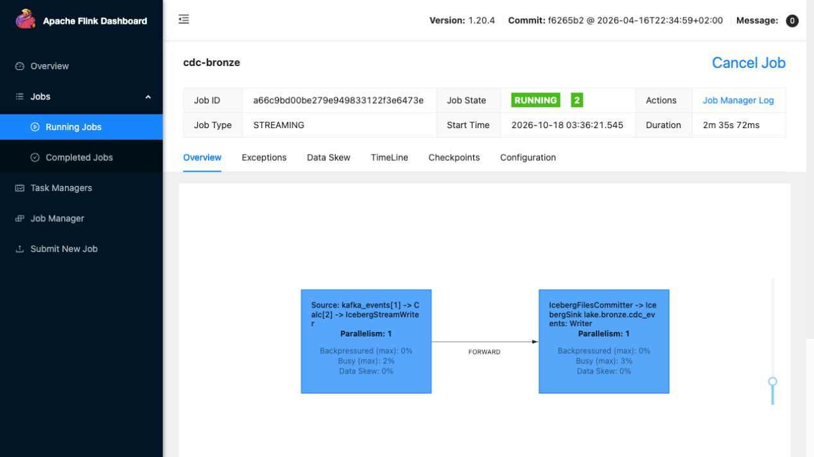

# 수정 큐시트 맥미니 재실행 — 2026-10-18

수정한 [강사 큐시트](https://docs.google.com/document/d/1-gsZuUtG_8VUtLItww2Bix8UQI2Ryia7yVdqjyten7U/edit)의 준비·수집 확인·종료 명령을 맥미니에서 다시 실행했다. **수업용 명령에서 오류는 없었고, 계획된 savepoint 재기동 뒤에도 기존 이력 보존과 새 변경 수집을 확인했다.** 과거 리허설 결과를 재사용하지 않고 아래 두 키로 새로 실행했다.

## 실행 결과

- 큐시트 실행 키: `s01-live-1018033710`
- 재기동 후 새 수집 키: `s01-resume-1018034344`

모든 환불 이벤트는 `cdc.public.refunds`, partition 0이다. `None`은 요약 출력의 JSON null 표현이다. wait 초는 **대기 명령을 시작한 뒤 Bronze에서 처음 관찰할 때까지의 시간**이며, 원천 commit부터의 정확한 지연이나 분석 마트 지연으로 해석하지 않는다.

| 실행 | 단계 | 원천 행 | before → after amount | offset | Bronze copies | wait 관찰 초 |
|---|---|---|---|---|---|---|
| 큐시트 순서 | insert | 1 | None → 20000 | 34 | 1 | 6.96 |
| 큐시트 순서 | update | 1 | 20000 → 30000 | 35 | 1 | 7.04 |
| 큐시트 순서 | delete | 0 | 30000 → None | 36 | 1 | 4.75 |
| 재기동 후 | insert | 1 | None → 20000 | 38 | 1 | 9.29 |
| 재기동 후 | update | 1 | 20000 → 30000 | 39 | 1 | 6.94 |
| 재기동 후 | delete | 0 | 30000 → None | 40 | 1 | 9.19 |

두 키 모두 DELETE 뒤 원천 0행, Bronze c/u/d 3건, Kafka null tombstone 1건이다. 수집 위치(topic·partition·offset)마다 copies=1임을 대조했다. 이 키에 대한 실험 결과이며, 전체 파이프라인의 end-to-end exactly-once 보장으로 확대하지 않는다.

## 큐시트 순서와 수업 화면

1. Airflow 정지 → `bootstrap.sh --no-build` → preflight → Flink UI SSH 터널 → 컨테이너·적재 SQL 확인.
2. 새 CASE_ID 생성 → payment 준비와 대기 → 각 환불 단계의 SQL 읽기 → DML → 원천 조회 → wait → Kafka 이벤트 출력 → collect-check 요약.
3. 핵심 helper 명령 17개는 큐시트와 순서가 같고 모두 종료 코드 0이다. 각 Kafka 이벤트 출력에 해당 단계의 c/u/d가 실제 존재하는지도 검사했다.
4. 각 단계 뒤 최소 60초 동안 실행·체크포인트 상태를 관찰했다. 이는 대기 구간 검증이며, 터미널 요약 화면이 고정된 UI까지 자동 검증했다는 뜻은 아니다.
5. 노트북에서 SSH 터널을 통해 실제 Flink 대시보드의 RUNNING 작업, 수집→Iceberg sink 구조, checkpoint 실패 0 및 savepoint restore 정보를 브라우저로 확인했다.

핵심 시연은 Bronze 수집에 한정했다. 시연 전후 Silver payments와 Gold settlement는 각각 10행으로 유지됐고, 시연 중 Silver·Gold refresh는 실행하지 않았다. bootstrap의 준비 작업에서 마트를 갱신하는 것과 구분한다.

## 종료·재기동 확인

- Bronze 전체 행 수: 실습 전 48 → 핵심 실습 뒤 53 → 재기동 직후 53 → 재기동 후 새 실습 뒤 58. 모든 관찰 시점의 중복 수집 위치는 0이다.
- 재기동 전후 Bronze의 전체 payload·수집 위치·timestamp를 포함한 해시가 같았다. Flink 복원 경로도 직전에 저장한 savepoint와 일치했다.
- 이미지 빌드·pull 없이 준비 작업까지 포함한 재기동 소요는 40.133초였다. 한 번의 관찰값이며 고정 소요 시간을 보장하지 않는다. 이미지 ID는 유지됐다.
- 재기동 후 이전 키 DELETE 대조와 새 키 c/u/d를 모두 통과했다. 핵심 시연 checkpoint 실패는 0이었다. 재기동 직후 태스크 초기화 중 trigger 취소가 1회 있었고, 그 뒤 새 실습 동안 추가 실패는 0이었다. VM 여유는 22.67GiB였다.
- 마지막에는 `scripts/stop.sh`로 CDC 프로젝트를 종료했다. savepoint `_metadata`의 실제 파일과 크기를 확인했고, 기존 DE7 Flink 컨테이너 두 개와 Lima VM은 유지했다.
- 최종 savepoint: `file:/opt/flink/state/savepoints/savepoint-9018b8-0cfdd8c5a209`.

## 기동 점검 보완

재기동 직후 RUNNING 직전의 태스크 초기화 중 `Not all required tasks are currently running`으로 checkpoint trigger가 한 번 취소됐다. 이후 완료 체크포인트는 계속 생성됐고, 새 변경 수집과 이력 보존도 통과했다. 누적 Failed=1은 숨기거나 초기화하지 않았다.

이를 계기로 preflight를 보완했다. 현재 job의 모든 태스크 RUNNING과 완료 체크포인트 최소 1개를 최대 45초 안에 확인한 뒤, 실제 세 테이블 조회 동안 새로운 실패가 늘지 않았는지 다시 검사한다. 새 버전을 맥미니에서 실제 실행해 `ready: true`, `baseline_checkpoint_failures: 1`, `checkpoint_failures_during_check: 0`과 최신 완료 ID를 확인했다. 점검 중 실패 증가나 준비 상태 상실은 오류로 처리한다. 수집 성공 자체는 여전히 c/u/d 이벤트 필드 대조로 판단한다.

## 큐시트 공식 근거 복원

원본 Google Docs의 관련 설명에 공식 문서 9종을 가리키는 클릭 링크 14개를 추가했다. Iceberg 1.10의 append·commit·JDBC Catalog, Table Spec의 v2 구조, Flink 1.20 raw·Kafka metadata·checkpoint 통계·REST API, Debezium 3.2 PostgreSQL 이벤트·tombstone, PostgreSQL 17 replica identity를 연결했다. 공식 설명과 이 실습의 구현 선택은 구분했다.

출처·멘트 보완 전후 코드블록 10개가 완전히 같고, 명령 33개·줄 연속 8개를 보존했다. 실제 링크 대상·절 앵커·접속 성공과 PDF 6쪽 전체 레이아웃을 확인했다. [출처 대조표](evidence/cuesheet-rerun-20261018/cue-official-sources.json)와 [문서 검증 결과](evidence/cuesheet-rerun-20261018/cue-reference-validation.json)를 보관한다.

사용자의 요청에 따라 Gemini 원본과 문단별로 다시 대조했다. 맞는 구성 소개·환불 시나리오·학생 예측 지시·원천 현재 행과 Bronze 이력 설명은 원래 문장과 구어체를 살렸다. 출력 필드, 오프셋 비교, 물리 삭제의 증분 조회 한계, timestamp와 commit 설명 등 실제로 고쳐야 하는 내용만 수정했다. 읽는 멘트와 강사 참고는 구분했다. [멘트 검증](evidence/cuesheet-rerun-20261018/cue-ment-validation.json)과 [원문 대조표](evidence/cuesheet-rerun-20261018/cue-ment-change-map.json)에 근거를 남긴다.

## 검증 범위

이번 기록은 수정 큐시트의 정상 실행, 단계별 60초 관찰, 계획된 savepoint 종료·재기동과 이후 새 변경 수집 검증이다. 2시간 연속 부하·모든 네트워크 장애·강제 프로세스 종료는 검증하지 않았다. 수업 당일에도 큐시트 STEP 0의 기동·preflight를 실행한다. 저장 지점을 지우거나 Kafka·볼륨을 초기화하지 않는다.

[증거 폴더](evidence/cuesheet-rerun-20261018/)에 두 실행의 이벤트 필드 대조·요약·wait, 명령별 소요, 전체 이력 해시, 체크포인트 관찰, 종료 확인을 보관한다. 비밀값이 들어갈 수 있는 렌더링된 설정·SQL·전체 bootstrap 로그는 배포하지 않는다. 증거의 UTC 시각은 한국 시간 10월 18일 실행에 해당한다.
