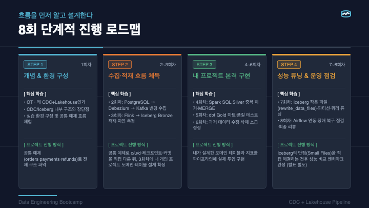

# 3회차 가이드 — Flink → Bronze 적재 심화, 개인 도메인·테이블 설계 확정

**공통 주문·결제·환불 예제 · 강사 맥미니 공유 화면 + 학생 예측·SQL·설계 · 개인 환경 복습**

Flink 선행 학습은 필요하지 않습니다. 역할과 SQL 예제부터 이해한 뒤 실행 구조와 복구 개념으로 넘어갑니다.

지난 시간에는 공통 예제의 PostgreSQL 변경을 Debezium과 Kafka에서 확인했습니다. 이번에는 같은 `orders`·`payments`·`refunds` 예제로 **Flink → Iceberg Bronze 적재와 지연**을 확인합니다. 그 사이에서 Flink와 Iceberg가 무엇을 하는지, 왜 Kafka에서 바로 파일로 복사하지 않는지, 파일이 생겼는데도 테이블 조회에는 안 보일 수 있는지 배웁니다. 작업이 멈추면 무엇이 있어야 다시 이어갈 수 있는지도 설명해봅니다.

수업을 마치면 도구 이름을 나열하는 대신 **“이 요구 때문에 이 구성을 골랐고, 이 증거로 동작을 확인하겠다”**고 말할 수 있어야 합니다. 마지막에는 각자의 도메인과 원천 테이블, 토픽·Bronze 보존 정보를 확정합니다.

## 첫날 로드맵에서 이번 수업의 위치



| 회차 | 이어갈 일 |
|---|---|
| 1 | 개념·환경을 익히고 공통 orders·payments·refunds의 전체 구조를 파악합니다. |
| 2–3 | 공통 예제로 수집·적재를 익힙니다. 2회차는 PostgreSQL → Debezium → Kafka, 3회차는 Flink → Bronze 적재·지연 측정입니다. 공통 c/u/d·checkpoint·commit을 다룬 뒤 3회차 말 개인 도메인·테이블 설계를 확정합니다. |
| 4–6 | 내 프로젝트에 Spark Silver 중복 제거·MERGE, dbt Gold·테스트, 수정·삭제·소급 정정을 구현합니다. |
| 7–8 | 7회차는 Iceberg rewrite_data_files·파티션·쿼리 튜닝, 8회차는 Airflow 연동·장애 복구·최종 리뷰입니다. 발표는 별도 일정입니다. |

공통 예제는 같은 결과를 보며 수집·적재를 이해하기 위한 기준입니다. 이후 개인 프로젝트를 모두 주문 도메인으로 통일하는 것은 아닙니다.

## 준비와 진행 방식

[설계 학습지](design-worksheet.md)를 처음부터 열어두세요. 지난 복습에서 확인한 결과·막힌 지점·질문, 관심 있는 업무 하나를 준비하면 됩니다. 주제가 아직 없다면 공간 예약·구독·물류·재고 중 하나로 시작해도 됩니다.

수업 중 실행과 화면 전환은 강사가 맥미니에서 진행합니다. 학생도 공통 예제의 결과를 먼저 예상하고 SQL을 작성·읽으며, 실제 수집 결과와 대조합니다. checkpoint·commit·같은 키 조회가 각각 무엇을 증명하는지 판단하고 학습지에 자신의 선택을 짧게 적습니다. 개인 서버 설치나 긴 명령 입력, 별도 `submission.md` 작성은 수업 진도로 삼지 않습니다. 실제 DDL을 완성하는 시간도 아닙니다.

집에서는 제공된 공통 전체 실행 프로그램으로 원천부터 Bronze까지 다시 확인합니다. 실행 방법은 [개인 실행 안내](../../docs/self-study.md)에 있습니다. 이미 실행 중이거나 멈춰 있는 환경에 새 job을 무조건 제출하지 않고, 안내에 따라 현재 상태에 맞는 실행 방식을 고릅니다. 수업 중 관찰을 위해 새 사건을 계속 만들 필요는 없습니다.

## 이번 수업의 순서

| 순서 | 다룰 것 | 공통 예제와 내 설계에서 확인할 것 |
|---|---|---|
| 1 | 첫날 로드맵·공통 원천 구조·변경 시나리오 | orders → payments → refunds와 c/u/d 기대값 |
| 2 | 업무 요구와 두 지연 목표 | 원천→Bronze와 원천→최종 지표의 차이 |
| 3 | Flink 첫 소개·배치와 스트리밍 | Kafka 다음 처리 주체와 이미 배운 Spark와의 관계 |
| 4 | 환불 한 건의 SQL·job 실행·복구 지점 | source·sink·JobManager·TaskManager·checkpoint를 순서대로 이해 |
| 5 | Iceberg 파일·테이블·commit과 선택 이유 | 파일과 테이블 확정의 경계, 대안과 운영 비용 |
| 6 | 공통 이력 → MinIO 파일 → 새 변경·지연 관찰 | 같은 키·파일·checkpoint·commit·SELECT 대조 |
| 7 | 운영 지표·장애 조사·보존 | 첫 확인 지점과 필요한 증거 |
| 8 | 개인 도메인·테이블 설계 확정 — 30분 | 원천 2~3개·키·변경·토픽·Bronze 정보 |
| 9 | 대표 설계 리뷰·전원 자가 점검 — 12분 | 받은 질문과 수정할 판단 |
| 10 | 정리와 후속 구현 | 확정한 것·보류한 것·다음 확인 |

## 1. 어떤 변경을 왜 받아야 하나요?

공통 예제는 [제공된 원천 SQL](../../sql/01-source.sql)의 세 테이블에서 시작합니다. `orders`는 주문 한 건, `payments`는 그 주문의 결제 한 건, `refunds`는 결제에 대한 환불 한 건을 담습니다.

| 테이블 | 한 행의 의미 | 키와 관계 |
|---|---|---|
| orders | 주문 한 건 | order_id PK |
| payments | 주문에 연결된 결제 한 건 | payment_id PK, order_id → orders |
| refunds | 결제에 연결된 환불 한 건 | refund_id PK, payment_id → payments |

결제 100,000원이 있고, 같은 환불 키로 다음 변경을 만듭니다. **이 예제에서 환불 행의 물리 삭제는 환불 철회**를 뜻합니다. 서비스마다 삭제의 업무 의미가 같지는 않으므로 개인 설계에서는 별도로 정합니다.

| 변경 | 원천 refunds의 현재 값 | 이번 환불 키의 Bronze 이력 |
|---|---|---|
| INSERT: 환불 20,000원 | 1행, amount=20000 | c 한 행 |
| UPDATE: 환불 30,000원으로 정정 | 1행, amount=30000 | c/u 두 행 |
| DELETE: 환불 철회 | 0행 | c/u/d 세 행 |

원천에서 사라진 환불이 Bronze에는 삭제 이력으로 남습니다. 현재 환불액과 그 값이 바뀐 경위는 답하는 질문이 다릅니다. 공통 수집·적재 범위는 **세 테이블 → Debezium → Kafka → Flink → Bronze**이며, 현재 상태를 만드는 Silver와 지표를 만드는 Gold 구현은 후속 회차입니다.

먼저 “누가 이 결과를 보고 어떤 결정을 내리는가”를 한 문장으로 적습니다. 그다음 목표를 두 개로 나눕니다.

- **원천 변경부터 Bronze 조회:** 변경 이력을 어느 정도 안에 확인해야 하나요?
- **원천 변경부터 최종 지표:** 업무에 사용할 값은 어느 정도 안에 바뀌어야 하나요?

하루 한 번 확정 보고서를 읽는 업무와 짧은 간격으로 환불 현황을 보는 업무는 같은 구성이 필요하지 않을 수 있습니다. 지연뿐 아니라 중간 변경 이력, 다시 계산할 입력, 원천 조회 부담과 운영할 서비스 수도 선택에 영향을 줍니다. 이 분석용 파이프라인이 서비스의 결제·환불 트랜잭션을 대신하는 것은 아닙니다.

학습지에는 목표와 필요한 이유를 적습니다. 제공된 설정값을 내 프로젝트의 지연 보장으로 그대로 복사하지 않습니다. 아직 정하지 못했다면 확인할 정보를 남깁니다.

## 2. Flink를 처음 만난다면 이 순서로 읽어보세요

### ① Kafka 다음에는 왜 처리 엔진이 필요한가요?

Kafka에 환불 이벤트가 들어왔다고 Iceberg 테이블에 저절로 적재되지는 않습니다. 이벤트를 계속 읽고 저장할 값을 골라 결과로 보내는 실행 주체가 필요합니다. **Flink는 계속 들어오는 데이터를 읽고 처리하는 실행 엔진**입니다. 이번에는 PostgreSQL을 직접 읽는 것이 아니라 Kafka를 입력으로 받아 Bronze 적재를 실행합니다.

Debezium은 DB 변경을 이벤트로 만들고, Kafka는 이를 보관·전달하며, Flink는 읽고 처리합니다. Iceberg는 결과 파일을 테이블로 관리합니다. 먼저 이 역할만 구분하면 됩니다. 복구나 저장 내부는 뒤에서 하나씩 연결합니다.

**스스로 확인:** Kafka에 도착한 사실만으로 Bronze에도 도착했다고 할 수 있나요? → 아닙니다. 처리·적재를 거쳐 실제 조회로 확인해야 합니다.

### ② 배치와 스트리밍은 무엇이 다른가요?

배치는 정해진 범위의 데이터를 처리해 종료하는 방식이고, 스트리밍은 계속 도착하는 입력을 이어서 처리하는 방식입니다. 이번 환불 변경처럼 입력이 계속 생기는 흐름을 스트림이라고 부릅니다.

이미 배운 Spark도 Structured Streaming으로 스트림을 처리할 수 있습니다. Spark는 배치만, Flink는 실시간만 가능한 도구라고 나누지 않습니다. 어떤 방식과 도구를 사용할지는 허용 지연·기존 환경·운영 부담으로 비교합니다. 이 스터디에서는 Flink로 지속 처리와 복구·테이블 확정의 연결을 배웁니다.

### ③ 환불 한 건은 어떻게 처리하나요?

입력을 읽는 곳을 **source**, 처리 결과를 보내는 곳을 **sink**라고 부릅니다. 이번 흐름은 Kafka source → null 필터·컬럼 선택 → Iceberg sink입니다. `kafka_events`의 Kafka 연결과 출력 Iceberg 테이블·Catalog 연결은 앞선 DDL(CREATE TABLE·CREATE CATALOG)로 미리 등록되어 있습니다. 아래 INSERT SELECT만으로 연결을 처음 만드는 것은 아닙니다. 환불 20,000원 생성 이벤트 한 건을 이 순서로 따라가 봅니다.

```sql
INSERT INTO lake.bronze.cdc_events
SELECT payload, topic, partition_id, kafka_offset, kafka_ts, CURRENT_TIMESTAMP
FROM kafka_events
WHERE payload IS NOT NULL;
```

`INSERT INTO`는 보낼 테이블, `SELECT`는 남길 값, `FROM`은 읽을 입력, `WHERE`는 남길 조건입니다. 지금은 SQL을 새로 제출하지 않고 실행 중인 작업의 의미를 읽습니다. `payload`에는 Kafka value 원문을 받습니다. **tombstone은 같은 키에 대해 value가 null인 Kafka 삭제 표시 레코드**입니다. 이 Debezium 예제에서는 d 본문 뒤에 옵니다. `WHERE payload IS NOT NULL`은 이 tombstone을 제외하며, Flink의 자동 삭제 정책이 아닙니다. 이 Kafka 입력에 대한 지속 INSERT가 제출 뒤 어떤 작업으로 실행되는지는 다음 단계에서 봅니다.

환불이 30,000원으로 정정되면 앞의 Bronze 행을 덮어쓰지 않고 정정 이력 한 행을 더 남깁니다. `op=d` 삭제 이벤트도 본문이 있어 보존하고, 뒤따르는 value 전체 null tombstone만 제외합니다. 현재 SQL은 업무 JOIN·집계·upsert·업무 중복 제거를 하지 않습니다. 원천 FK를 Bronze에 자동으로 강제하지도 않습니다. 현재 상태 계산은 후속 Silver가 맡습니다.

**스스로 확인:** 원천에서 같은 환불을 생성·정정·삭제하면 Bronze의 앞선 이력도 사라질까요? → 아닙니다. 이번 구성에서는 c/u/d 세 이력이 남습니다.

### ④ 제출한 SQL은 누가 실행하나요?

**SQL Client**는 SQL을 제출하는 도구입니다. 제출되어 실행되는 처리 작업을 **job**이라고 부르고, job을 나눠 실제로 실행하는 단위를 **task**라고 부릅니다. 이번 Kafka 입력에 대한 지속 INSERT는 새 입력을 계속 처리하는 job이 됩니다. SQL을 입력한 창이 직접 매번 Kafka를 읽는 것은 아닙니다.

**JobManager**는 작업 실행을 조정하고, **TaskManager**는 실제 입력 읽기·처리·출력 작업을 실행합니다. source → 처리 → sink는 논리 단계이므로 반드시 서버 세 대라는 뜻이 아닙니다.

**스스로 확인:** JobManager와 TaskManager는 각각 무엇을 하나요? → JobManager는 작업을 조정하고, TaskManager는 실제 task를 실행합니다. 그림의 논리 단계 수와 서버 수는 같은 뜻이 아닙니다.

### ⑤ 읽은 직후 작업이 멈췄다면 어떻게 하나요?

환불 이벤트를 읽던 중 작업이 멈췄다고 가정해 봅니다. 너무 앞에서 새로 읽으면 이미 저장한 이력을 다시 추가할 수 있고, 너무 뒤에서 시작하면 아직 저장하지 못한 입력을 놓칠 수 있습니다. Kafka에 원문이 있다는 것만으로 시작 위치가 정해지지는 않습니다.

다시 처리하려면 **읽은 위치와 처리 중인 상태**를 함께 알아야 합니다. 집계가 없는 이번 작업에도 입력 위치와 적재 중인 파일 작업 정보가 필요합니다. 마지막으로 읽었다는 사실과 테이블에 확정했다는 사실은 다릅니다.

### ⑥ Checkpoint는 이어서 처리할 복구 지점입니다

**checkpoint는 입력 위치와 처리 상태를 일관된 복구 지점으로 저장하는 기능**입니다. 저장 → 중단 → 복원 → 이어서 처리의 순서로 이해합니다. 작업이 멈추면 저장한 위치와 상태를 복원하고 그 뒤 구간을 다시 처리할 수 있습니다.

checkpoint는 Kafka 원문 전체나 원천 DB 전체의 복사본이 아닙니다. 복구에 필요한 입력·상태·관련 파일이 보존돼야 합니다. 상태 없이 새 job을 제출해 보관된 과거 입력을 다시 읽는 것과 저장된 상태에서 복원하는 것도 다릅니다.

이번 실습에서 설정한 10초는 checkpoint **시도 간격**입니다. 매번 10초 안에 완료되거나 환불이 10초 안에 조회된다는 보장은 아닙니다. 파일 준비와 테이블 확정의 연결은 4~5절에서 이어갑니다.

**스스로 확인:** checkpoint만 있으면 Kafka에서 보관 기간이 지나 사라진 원문도 되살릴 수 있나요? → 아닙니다. checkpoint는 원문 전체 복사본이 아니며, 이어서 읽을 입력도 보존돼야 합니다.

[Flink 공식 개념](https://nightlies.apache.org/flink/flink-docs-release-1.20/docs/concepts/overview/), [실행 구조](https://nightlies.apache.org/flink/flink-docs-release-1.20/docs/concepts/flink-architecture/), [Checkpointing](https://nightlies.apache.org/flink/flink-docs-release-1.20/docs/dev/datastream/fault-tolerance/checkpointing/).

### Iceberg — 파일을 일관된 테이블 상태로 관리하는 형식

**metadata는 스키마·테이블 상태·파일 참조 등을 설명하는 정보**입니다. **snapshot은 일관된 테이블 상태**, **Catalog는 테이블 이름에서 현재 metadata 파일의 위치를 찾는 곳**입니다.

Parquet는 실제 행과 컬럼을 파일에 담는 형식입니다. Iceberg는 그 파일 중 무엇을 어떤 스키마와 테이블 상태로 읽을지 관리하는 개방형 테이블 형식입니다. 파일 저장은 S3 호환 저장소, SQL 계산은 Flink나 Spark가 담당합니다. Iceberg 자체가 별도 쿼리 서버나 S3 저장소인 것은 아닙니다.

| 구성 | 이 프로젝트에서 하는 일 |
|---|---|
| Flink | Kafka 입력을 계속 읽고 Bronze 적재를 실행 |
| S3 호환 저장소 | 실제 Parquet와 Iceberg metadata 파일 보관 |
| Iceberg | 스키마·snapshot·파일 참조와 테이블 변경 규칙 제공 |
| 별도 PostgreSQL JDBC Catalog | 테이블 이름에서 현재 metadata 파일 위치 관리 |
| Spark | 같은 Iceberg 테이블을 조회하고 후속 Silver 변환 실행 |
| dbt | 후속 Gold SQL 모델의 의존성과 검증 관리 |

원천 PostgreSQL에는 서비스 테이블이 있고 Catalog PostgreSQL에는 테이블 metadata의 위치가 있습니다. 실제 Bronze 행을 Catalog DB에 넣는 구조가 아닙니다. Flink와 Spark가 같은 Catalog를 보는 이유는 같은 테이블의 현재 참조에서 읽고 쓰기 위해서입니다. [Iceberg 소개](https://iceberg.apache.org/docs/1.10.0/), [JDBC Catalog](https://iceberg.apache.org/docs/1.10.0/jdbc/).

## 3. 이미 배운 Spark로 하면 안 되나요?

가능합니다. 이번 조합을 배우는 것과 모든 업무에서 이 조합이 최선이라는 말은 다릅니다.

| 대안 | 검토할 상황 | 확인할 조건·비용 |
|---|---|---|
| 정기 배치·수정 시각 증분 | 허용 지연이 길고 추출 범위가 명확함 | 원천 조회 부하, 물리 삭제·중간 변경·늦은 정정 포착 |
| Kafka → Spark Structured Streaming → Iceberg | 기존 Spark 운영을 활용하고 마이크로배치(입력을 작은 구간으로 나누어 처리)가 요구 지연을 만족함 | trigger(실행 주기)·checkpoint·출력 연결 호환, 파일과 commit 관리 |
| Kafka → Iceberg Connect sink | connector(연결 도구)의 변환·라우팅(출력 경로 선택)·적재 의미로 충분함 | 입력 형식·설정·버전 호환과 commit 조정 |
| Kafka → Flink → Iceberg | 지속 처리와 복구 상태·출력 경계를 분리해 다룸 | 새 엔진의 상시 리소스, 상태 저장·관측·유지 관리 |

Kafka 없이 직접 CDC 적재를 맡는 구조도 도구의 source/sink 지원과 재처리 요구에 따라 검토할 수 있습니다. 그때는 브로커의 보관·소비자 분리가 없어져도 괜찮은지, 원천 로그와 복구 위치를 누가 관리하는지 확인해야 합니다.

이번 공통 구현은 **원문과 전달 위치를 남기고, 연속 처리의 복구 상태와 테이블 commit을 분리해 배우기 위해** Flink와 Iceberg를 사용합니다. 단순 raw append만 필요하다면 Connect sink나 기존 Spark를 활용하는 구성이 더 단순할 수 있습니다. 여기서 대안의 성능·비용 우위를 측정한 것은 아닙니다. Spark Structured Streaming도 스트림을 처리하며, 이 Iceberg 통합은 micro-batch 쓰기를 지원합니다. Spark의 experimental continuous 모드를 이 Iceberg sink에서도 사용할 수 있다고 혼동하지 않습니다.

지연을 줄이려고 commit 기회를 자주 만들면 작은 파일과 snapshot·metadata 관리 부담이 늘 수 있습니다. checkpoint 간격이 짧다고 매번 새 파일·snapshot이 반드시 생기거나 그 간격 안에 조회된다고 보장하지는 않습니다. 실제 Parquet·Iceberg metadata 파일은 MinIO에 저장되고, 별도 Catalog PostgreSQL은 현재 metadata 위치를 관리합니다. metadata 파일 자체를 Catalog DB에 쌓는 구성은 아닙니다.

학습지에는 선택 이유 하나, 비교한 대안 하나, 감수할 부담 하나만 먼저 적습니다. [Spark Structured Streaming](https://spark.apache.org/docs/3.5.6/structured-streaming-programming-guide.html), [Iceberg streaming 쓰기](https://iceberg.apache.org/docs/1.10.0/spark-structured-streaming/), [Connect sink](https://iceberg.apache.org/docs/1.10.0/kafka-connect/).

## 4. Flink는 무엇을 받아 무엇을 남기나요?

### 원문과 전달 정보를 나눠 읽기

[실제 적재 SQL](../../flink/ingest.sql.template)의 `format='raw'`는 Kafka value를 `payload STRING`으로 받습니다. 여기서 Debezium JSON을 현재 상태 테이블로 해석하지 않습니다. 현재 보존하는 원문은 Kafka value이며 key·headers 전체를 저장하는 구성은 아닙니다. 원문을 남기므로 나중에 해석 규칙을 바꿔 다시 확인할 근거가 생깁니다. 대신 저장량이 늘고, 이후 파싱·스키마 검증 책임이 남습니다. 잘못된 JSON 문자열도 이 필터만으로 걸러지지 않습니다.

전달 위치는 같은 Kafka 레코드인지 확인할 때 사용합니다. 토픽·파티션·offset(그 토픽·파티션 안의 레코드 위치)을 함께 읽으며, 업무 키는 같은 환불을 찾는 데 사용합니다. 아래 문법은 첫 독해 뒤 필요할 때 확인합니다.

<details>
<summary>심화 참고 — Kafka metadata 문법과 복원 위치</summary>

```sql
payload STRING,
topic STRING METADATA FROM 'topic' VIRTUAL,
partition_id INT METADATA FROM 'partition' VIRTUAL,
kafka_offset BIGINT METADATA FROM 'offset' VIRTUAL,
kafka_ts TIMESTAMP_LTZ(3) METADATA FROM 'timestamp' VIRTUAL
```

`METADATA FROM`으로 Kafka가 제공하는 전달 정보를 읽습니다. `VIRTUAL`은 이 컬럼을 Kafka 테이블의 쓰기 대상 스키마에서 제외한다는 뜻입니다. 2절 ③의 SELECT에서 골라 보내면 Bronze 일반 컬럼으로 보존됩니다. offset은 토픽·파티션과 함께 읽으며 전역 업무 순번으로 사용하지 않습니다.

`earliest-offset`은 복원할 상태가 없을 때 보관된 가장 이른 위치에서 시작하는 설정입니다. checkpoint에서 복원할 때는 저장된 입력 위치를 사용합니다. 상태 없이 새 job을 earliest로 제출하는 것은 기존 상태의 복구와 다르며, 기존 Bronze에 과거 입력을 다시 append할 수 있습니다.

</details>

### 삭제 사건과 tombstone을 구분하기

다음 설명은 삭제 사건을 Debezium envelope로 보존하는 이 공통 예제의 전제입니다. 일반 Kafka 토픽에서는 tombstone 자체가 삭제 신호일 수 있으므로 같은 필터를 그대로 적용하지 않습니다.

위 2절 ③에서 읽은 INSERT SELECT가 이 필터를 적용합니다.

처리 흐름은 **Kafka source → null 필터·컬럼 선택 → Iceberg writer → 전체 checkpoint 완료 통지 → committer의 테이블 확정**입니다. source에서 원문과 전달 위치를 읽고, SELECT에서 남길 컬럼과 Flink 처리 시각을 선택합니다. writer가 파일을 준비한 것과 테이블 commit을 마친 것은 다른 단계이며, commit을 거쳐야 새 조회에서 읽을 수 있습니다. 각 경계의 차이는 다음 절에서 확인합니다.

| Kafka 입력 | 필터·SELECT의 처리 | Bronze에 남는 것 |
|---|---|---|
| 환불 생성 `op=c` | 본문과 전달 정보를 선택 | 생성 이력 한 행 |
| 환불 정정 `op=u` | 본문과 전달 정보를 선택 | 수정 이력 한 행 |
| 환불 철회 `op=d` | 본문이 있으므로 통과 | 삭제 이력 한 행 |
| tombstone | value 전체가 null이므로 제외 | 추가하지 않음 |

`op=d`의 `after=null`은 value 전체 null과 다릅니다. 같은 업무 키의 c/u/d는 각각 이력 행으로 append하며, 기존 Bronze 행을 수정·삭제하지 않습니다. 업무 키 upsert·현재 상태 계산·업무 중복 제거도 하지 않습니다. 원천 FK 제약을 Bronze에 자동으로 강제하거나 여러 테이블 사이의 전역 순서를 보장하는 처리도 아닙니다.

`kafka_ts`는 Kafka 레코드 시각이고 `ingested_at`은 SELECT의 `CURRENT_TIMESTAMP`로 채운 Flink 처리 시각입니다. 어느 쪽도 원천 DB 또는 Iceberg 테이블 commit 시각의 직접 증거는 아닙니다.

### 파일 준비와 테이블 확정은 다릅니다

들어오는 행을 파일에 계속 쓰고, 복구 지점을 준비할 때 열린 파일을 마무리하며 어떤 파일을 준비했는지 남깁니다. 전체 checkpoint 완료 통지를 받은 뒤 준비한 결과를 테이블 상태로 확정합니다. 이 확정을 commit이라고 부릅니다. Parquet는 읽는 데 필요한 footer(파일 끝의 메타데이터)까지 마무리해야 완성된 파일로 읽을 수 있습니다. 파일이 보이는 시점과 현재 테이블의 새 SELECT로 그 행을 읽는 시점을 나누어 봅니다.

이벤트 한 건마다 파일 하나가 생기거나, checkpoint 전에는 모든 입력이 메모리에만 머문다고 이해하지 않습니다. 여러 행이 같은 파일에 들어갈 수 있고 내부 버퍼·업로드도 있습니다. 구현 이름은 이 흐름을 이해한 뒤 확인합니다.

<details>
<summary>심화 참고 — Iceberg writer와 checkpoint 구현</summary>

레코드는 들어올 때 writer의 파일 쓰기 경로로 전달됩니다. checkpoint가 올 때까지 모든 입력을 메모리에만 모아두었다가 처음 쓰는 구조가 아닙니다. 다만 내부 버퍼·인코딩·업로드가 있으므로 레코드 한 건이 도착한 즉시 콘솔에 완성된 Parquet 오브젝트가 보인다고도 말할 수 없습니다.

현재 코드가 선택하는 Iceberg 1.10 기본 sink 경로에서는 checkpoint barrier를 넘기기 전에 열린 파일을 마감하고 파일 결과를 committer로 보냅니다. committer는 아직 테이블에 확정하지 않은 파일의 참조를 checkpoint 상태에 남기고, 전체 checkpoint 완료 통지를 받은 뒤 미확정 결과의 테이블 commit을 진행합니다. 클래스 이름보다 **파일 준비·복구 상태 저장·테이블 확정이 다른 단계**라는 점을 이해합니다. [Writer 구현](https://raw.githubusercontent.com/apache/iceberg/apache-iceberg-1.10.0/flink/v1.20/flink/src/main/java/org/apache/iceberg/flink/sink/IcebergStreamWriter.java), [Committer 구현](https://raw.githubusercontent.com/apache/iceberg/apache-iceberg-1.10.0/flink/v1.20/flink/src/main/java/org/apache/iceberg/flink/sink/IcebergFilesCommitter.java).

</details>

## 5. Iceberg는 어떤 파일을 읽을지 어떻게 정하나요?

이 프로젝트는 Iceberg format v2를 사용합니다. 기본 SELECT는 **현재 snapshot**을 읽습니다. 아래의 “선택한 snapshot”은 이 기본 조회에서 현재 상태를 가리킵니다. 다음 순서로 테이블을 찾습니다.

```text
Catalog의 현재 metadata 위치
  → metadata.json의 스키마·snapshot 정보
  → 선택한 snapshot의 manifest list
  → manifest가 가리키는 data 파일
  → 실제 Parquet 행
```

snapshot은 테이블의 일관된 상태입니다. 매번 전체 데이터를 복사하는 것이 아니라 이전 파일을 재사용하면서 새 상태를 표현할 수 있습니다. format v2의 manifest list·manifest는 Avro이며, 데이터 행을 담은 Parquet와 역할이 다릅니다. Bronze `op=d`는 일반 data 행이지 Iceberg Delete File이 아닙니다.

쓰기 엔진은 새 파일과 metadata를 준비하고 Catalog의 현재 metadata 참조를 원자적으로 갱신해 commit합니다. 현재 JDBC Catalog에서는 이전 참조를 조건으로 갱신하므로 다른 쓰기와 충돌하면 재시도·실패 처리가 필요합니다. 이것은 **한 테이블의 변경 경계**이지 여러 원천 테이블을 동일 트랜잭션 시점에 동시에 확정하는 보장은 아닙니다.

조회 엔진은 자신이 로드한 snapshot을 읽습니다. 이 예제의 Spark는 Catalog cache를 끄도록 설정돼 있지만, 이미 실행한 SELECT나 결과 그리드가 자동으로 최신 값으로 바뀌지는 않습니다. 새 조회로 확인하고, 보존된 snapshot 중 시각상 최신 행만 보고 항상 current라고 판단하지 않습니다. [테이블 일관성과 commit](https://iceberg.apache.org/docs/1.10.0/reliability/), [format v2 명세](https://raw.githubusercontent.com/apache/iceberg/apache-iceberg-1.10.0/format/spec.md).

### checkpoint와 commit은 같은가요?

| 경계 | 남기는 것·뜻 | 그것만으로 증명하지 못하는 것 |
|---|---|---|
| Flink checkpoint | 복구할 입력 위치와 처리·sink 상태 | 해당 키가 Iceberg에 조회되는지 |
| Iceberg commit | 테이블의 현재 metadata 참조와 snapshot 변경 | 특정 업무 키의 내용·최종 지표의 정확성 |
| 같은 키의 새 SELECT | 이 조회에서 실제 행이 읽힘 | 원천 commit부터의 전체 지연·모든 재처리 보장 |

checkpoint 성공 뒤에도 Iceberg commit은 실패할 수 있습니다. checkpoint 성공 숫자만으로 이번 환불의 도착을 판단하지 않고, 해당 키로 새 SELECT를 실행해 확인합니다.

<details>
<summary>심화 참고 — commit 복구와 과거 snapshot</summary>

명시적 과거 상태 조회(time travel)는 보존된 다른 snapshot을 선택하는 별도 사용법입니다. 기본 현재 조회와 구분합니다.

pending은 아직 테이블에 확정하지 않은 결과를 뜻합니다. 복구 시에는 남은 pending 파일 참조와 snapshot summary의 job·operator·최대 commit checkpoint 정보를 대조해 같은 파일의 중복 commit을 피하도록 설계돼 있습니다. 상태·입력·관련 파일이 보존돼야 하며, 다른 offset으로 다시 발행된 업무 이벤트의 중복 제거와는 다릅니다. 빈 checkpoint나 미확정 결과의 처리 때문에 checkpoint 한 번마다 새 snapshot 하나가 생긴다고도 보장하지 않습니다. 두 ID를 일대일로 맞추지 않습니다. [Flink Writes](https://iceberg.apache.org/docs/1.10.0/flink-writes/).

실패 시점에 따라 복구할 대상도 구분합니다.

| 실패 시점 | 복구의 출발점 |
|---|---|
| 최근 성공 checkpoint에 포함되지 않은 입력을 처리하던 중 | 마지막 성공 checkpoint에 저장한 입력 위치와 상태부터 재처리합니다. 작성만 하고 commit하지 않은 객체는 테이블에 포함되지 않으며, 물리 객체가 자동으로 사라진다고 단정하지 않습니다. |
| 성공 checkpoint에 pending 파일 참조는 남았지만 commit 결과가 불확실함 | 보존된 상태와 snapshot의 commit 기록을 대조해 이미 확정한 범위와 아직 처리할 결과를 구분합니다. |

아직 checkpoint에 담기지 않은 입력의 재처리와, 완료 checkpoint에 남은 pending 결과의 복구를 같은 상황으로 설명하지 않습니다.

checkpoint·savepoint는 별도 `flink-state` Docker 볼륨에 있고, Iceberg data·metadata는 S3 호환 저장소에 있습니다. Catalog DB도 별도 볼륨입니다. 한 곳의 파일만 남아 있다고 전체 복구가 되는 것은 아닙니다. 이번 단일 맥미니 구성은 호스트·JobManager 전체 장애에 대한 HA나 원격 상태 백업을 제공하지 않습니다.

</details>

## 6. raw 이력에서 MinIO와 테이블 조회까지 연결하기

관찰용 SQL은 [metadata-inspection.sql](metadata-inspection.sql)에 있습니다. **A–D는 Spark SQL / Iceberg Bronze 연결**, **E는 별도 Catalog PostgreSQL 연결**입니다. 한 파일 전체를 같은 연결에서 실행하지 않고 해당 화면의 SELECT 하나씩 읽습니다. 원천 PostgreSQL 연결과도 구분합니다. DBeaver는 강사의 조회 도구이며 학생 필수 설치 항목을 추가하지 않습니다.

### 관찰 A — 환불 철회 뒤 무엇이 남나요?

강사가 공통 환불 c/u/d가 끝난 준비 키 하나를 읽습니다. 먼저 원천 현재 행과 Bronze 이력 수를 예상합니다. 기대는 원천 0행, Bronze c/u/d 세 이력입니다. 실제 결과와 비교하면서 `op=d` 보존과 tombstone 제외를 앞의 SQL에 연결합니다. 이 예제에서 같은 환불 키의 Kafka 레코드는 c/u/d와 wire-null tombstone을 합쳐 네 개, Bronze에는 본문이 있는 세 이력이 남습니다.

같은 PK의 이력 세 행은 현재 업무 건수 세 건이 아닙니다. 이 공통 CASE의 주문·결제 생성 이력까지 포함하면 Bronze는 주문 1 + 결제 1 + 환불 3 = 5행입니다. **이번 CASE에 속한 이력 수이며 Bronze 전체 테이블의 COUNT가 아닙니다.** 파일 수도 반드시 세 개가 아닙니다. 이후 현재 상태를 고르는 책임은 Spark Silver, 지표 계산은 dbt Gold에 둡니다. 지금은 그 후속 모델을 새로 구현하지 않습니다.

### 관찰 B — MinIO 파일 확인: 실제 저장과 테이블 참조 잇기

먼저 이론에서 본 참조 방향을 따라가고, 그다음 SQL로 교차 확인합니다. 파일명이나 시각에서 현재 테이블을 추측하지 않습니다.

1. **현재 참조 → JSON:** E의 별도 Catalog PostgreSQL 조회에서 `metadata_location`을 확인합니다. 강사 파일 뷰어의 Object Browser에서 **`warehouse` → `bronze/cdc_events` → `metadata`**의 같은 JSON 객체를 찾습니다. 필요하면 전체 객체 prefix로 검색합니다. 별도 Catalog 화면이 없으면 기존 helper에서 읽은 현재 참조를 강사 화면으로 확인합니다.
2. **JSON → 파일 목록 → data:** 콘솔은 Name·Size·Last Modified 등 물리 객체 정보를 확인하는 화면으로 사용합니다. **현재 수업 환경에서는 metadata JSON Preview가 되지 않습니다.** 강사가 사전에 Download한 JSON을 로컬 텍스트 편집기로 열어 `current-snapshot-id`를 검색합니다. 파일이 크면 수업 중 다운로드를 기다리지 않습니다. Download 당시의 `metadata_location`·객체 경로·Download 시각을 함께 남기고 준비 파일과 대조합니다. 이후 pointer가 바뀌었다면 과거 시점의 준비본으로 구분하며 현재 파일이라고 부르지 않습니다. snapshot 정보·manifest list 경로를 연결한 뒤 **`data`**의 Parquet 객체 경로·크기·수정 시각을 봅니다. 화면의 폴더는 객체 key의 prefix입니다. 이 프로젝트의 format v2 manifest list·manifest는 Avro여서 콘솔에서 평문 JSON처럼 읽는 파일이 아닙니다.
3. **SQL 교차 확인:** A의 `snapshots`, C의 `metadata_log_entries`, B의 `files`에서 snapshot·JSON·data 경로를 대조합니다. 시간상 최신 snapshot이나 수정 시각이 최신인 JSON이 항상 current라는 뜻은 아닙니다. `files.record_count`는 파일 전체 행 수이며 특정 환불 키의 이력 수와 다릅니다.
4. **같은 키로 돌아오기:** D의 `_file`과 topic·partition·offset·op를 확인해 해당 행의 data 파일을 연결합니다. 파일 표본 3개에 이번 경로가 없다고 누락으로 판단하지 않습니다. 여러 이벤트가 같은 `_file`에 들어갈 수 있으며 이벤트 한 건마다 별도 파일이 생기는 것은 아닙니다.

오브젝트가 존재한다는 것, 현재 테이블이 그 파일을 참조한다는 것, 이번 키가 조회된다는 것은 다른 증거입니다. `.files`는 metadata 조회이므로 이것만으로 Parquet bytes 전체를 디코드했다고 말하지 않습니다. 실제 물리 내용은 기존 Parquet 확인 도구의 증거와 구분합니다. 조회가 늦어지면 준비된 기록을 쓰되 과거 기록임을 표시하고, 테이블·버킷을 새로 만들거나 파일을 지워 해결하지 않습니다.

### 관찰 C — Kafka에 있으면 Bronze에도 보이나요? 지연은 어디서부터 재나요?

**관찰 A·B의 기존 이력, MinIO JSON과 SQL 대조를 마친 뒤** 새 환불 한 건을 측정합니다. 공통 예제의 기존 경로로 주문·결제까지 사전 준비한 새 `CASE_ID`를 사용합니다. 측정 전 이번 환불 키가 원천과 Bronze 모두 0행이어야 합니다. 기존 c/u/d 완료 키를 다시 쓰지 않습니다.

강사는 맥미니에서 프로젝트의 **Linux runner**로 아래 측정 도구를 실행합니다. 학생은 어떤 값을 언제 확인해야 하는지 먼저 예상하고, 출력의 관찰 시각과 결과를 대조합니다.

```bash
./labs/session03/measure-latency.sh "$CASE_ID" --insert-refund --timeout 180 --poll-interval 1 --run-label live
```

이 명령 안에서 환불 20,000원 INSERT와 명시적 commit, 첫 Bronze 조회를 이어서 수행합니다. **별도의 refund 명령을 먼저 실행하거나 같은 INSERT를 한 번 더 실행하지 않습니다.**

| 관찰점 | 같은 runner가 기록하는 경계 |
|---|---|
| t0 | 환불 INSERT 호출 직전 |
| t1 | 명시적 commit 응답을 받은 직후 |
| t2 | 같은 refund_id·op=c·after.amount=20000·준비한 payment_id를 모두 만족하는 첫 Bronze SELECT가 반환된 직후 |

시각 차이는 같은 프로세스의 monotonic clock으로 잽니다. **`request_to_observation_seconds`는 t2−t0, INSERT 호출부터 첫 조회 확인까지**이며, **`commit_ack_to_observation_seconds`는 t2−t1, commit 응답 뒤 첫 조회 확인까지**입니다. `polls`·`observation_interval`과 `matched_record`도 함께 읽습니다. t1은 DB 내부의 실제 commit 시각이 아닙니다. 이 관찰값에는 polling 간격·쿼리 실행·응답 시간이 포함되므로 Iceberg 테이블 commit 자체의 소요 시간이나 고정 SLA로 부르지 않습니다.

`live`는 현장 측정을 구분하는 표시이고 사전 검증·개인 실행은 `rehearsal`로 구분합니다. INSERT 실행 옵션이 없는 기본 호출은 연결·DML 없이 계획 JSON만 보여줍니다.

기존 `wait_observed_seconds`는 **wait 명령 시작부터 첫 Bronze 관측까지**인 보조 관찰값입니다. INSERT 전에 시작하는 이번 측정값과 섞지 않습니다. Kafka 전달 위치와 checkpoint·최근 snapshot은 어느 구간이 진행했는지 살피는 별도 증거이며, 이 순차 조회를 같은 순간의 상태로 취급하지 않습니다. Gold 지연은 후속 마트 실행까지 확인해야 합니다.

중간 상태가 너무 빨리 지나가면 없었던 지연을 연출하지 않습니다. timeout이 나거나 commit 응답을 받지 못해 성공 여부가 불명확하면 출력과 현재 데이터를 남기고 조사합니다. **곧바로 INSERT를 재시도하거나 기존 행·파일을 지우지 않습니다.** 재시작·설정 변경·중복 job 제출로 결과를 맞추지 않습니다.

## 7. 실제 운영에서는 무엇을 봐야 하나요?

job의 RUNNING 여부는 출발점입니다. 새 입력이 있는지, 처리와 복구 지점이 진행하는지, 테이블 commit과 조회가 따라오는지를 함께 봅니다.

| 관측 | 확인하는 질문 | 그다음 판단 |
|---|---|---|
| 입력·소비 위치/적체 추세 | Kafka에 새 변경이 있고 소비가 따라가나요? | 같은 키·조건, Flink 입력과 하류 진행 확인 |
| busy·idle·backpressure | 일이 없나요, 처리 중인가요, 하류가 막나요? | 느린 연산자·스토리지·리소스·오류를 좁혀 조사 |
| checkpoint 성공 시점·소요·실패 | 복구 지점이 계속 만들어지나요? | 실패 증가분·barrier 지연·상태 저장을 확인 |
| 마지막 commit·commit 소요 | 테이블 상태 갱신이 진행하나요? | 입력이 있는데 멈췄는지, committer·Catalog·저장소 확인 |
| 해당 키 SELECT | 이번 변경을 실제로 읽을 수 있나요? | 조건·토픽·offset·새 조회 결과를 대조 |
| 파일 크기·개수·metadata 증가 | 신선도를 얻는 대신 어떤 비용이 늘었나요? | 입력량·주기·writer 수·보존·유지 관리 검토 |

`elapsedSecondsSinceLastSuccessfulCommit`은 마지막 성공 commit 이후 시간입니다. 입력이 없는 구간에서 이 값이 증가한다고 바로 장애는 아닙니다. 입력이 있고 checkpoint는 성공하는데 조회가 오래됐다면 commit 경로도 조사할 이유가 생깁니다. Kafka lag가 작다는 이유만으로 commit 장애를 확정하지도 않습니다. 위 지표가 모두 현재 helper의 보고서에 구현돼 있다는 뜻은 아닙니다. [Checkpoint 관찰](https://nightlies.apache.org/flink/flink-docs-release-1.20/docs/ops/monitoring/checkpoint_monitoring/), [sink 지표](https://iceberg.apache.org/docs/1.10.0/flink-writes/#metrics).

### 짧은 주기가 항상 좋은가요?

checkpoint 간격이 짧으면 정상 상태에서 commit 기회를 자주 가질 수 있지만 파일 마감·metadata·commit 작업도 잦아집니다. 낮은 입력량에서는 작은 파일이 늘 수 있습니다. 길게 하면 빈도 비용을 줄일 여지가 있지만 조회 대기와 미확정 처리 범위가 커질 수 있습니다. 이번 실습에서 설정한 10초는 학습 설정이며 지연 상한이 아닙니다.

목표 파일 크기도 매 파일의 실제 크기를 보장하지 않습니다. writer 수나 partition을 늘리면 처리 여지가 생기는 동시에 파일·메모리·commit 비용이 달라집니다. 현재 예제는 원천 하나·토픽당 파티션 하나·parallelism 1이며 대규모 처리량이나 다중 파티션 순서를 검증한 구성이 아닙니다.

### 장애 사례에서 다음 증거 고르기

- **Kafka에는 새 변경이 있고 RUNNING인데 Bronze가 오래됨:** 같은 키와 조회 조건, 입력 처리, checkpoint, commit 순서로 근거를 더 봅니다. 곧바로 한 원인을 확정하지 않습니다.
- **checkpoint 성공 뒤 commit이 멈춘 듯함:** 새 입력 유무와 최근 commit, committer·Catalog·스토리지 오류를 확인합니다. checkpoint 성공만으로 완료 판정하지 않습니다.
- **파일과 metadata가 계속 늘어남:** 실제 크기 분포와 조회 비용을 보고 commit 주기·compaction·보존을 검토합니다. 콘솔에서 파일을 수동 삭제하지 않습니다.
- **정지 뒤 재개해야 함:** 남은 checkpoint/savepoint·입력 보관 범위·Catalog·파일을 먼저 확인합니다. 상태 없는 earliest 재제출을 기존 복구로 취급하지 않습니다.

compaction, snapshot 만료, orphan 파일 정리는 목적이 다릅니다. 현재/과거 조회와 진행 중 쓰기, Flink 복구가 필요한 파일까지 고려해 정책을 정해야 합니다. 아직 commit하지 않은 정상 pending 파일을 곧바로 orphan으로 판단하지 않습니다. 정리 기준은 쓰기·commit 지연과 복구에 필요한 기간을 확인해 정하며 임의의 보존 일수를 여기서 처방하지 않습니다. 자동 compaction·원격 백업·실무 보안·HA가 이 수업 환경에 완성돼 있는 것은 아닙니다. raw 원문에 남길 컬럼과 보존·접근 범위도 실무에서는 설계해야 합니다. 수업과 개인 예제에는 합성 데이터를 사용합니다. [유지 관리](https://iceberg.apache.org/docs/1.10.0/maintenance/).

## 8. 개인 도메인·테이블 설계 확정 — 30분

수업 중 적은 선택을 바탕으로 기존 학습지를 정리합니다. 빈 양식을 새로 늘리는 시간은 아닙니다.

1. **업무와 원천:** 도메인·사용자·업무 질문, 테이블 2~3개의 이름·한 행의 의미·PK/FK를 정합니다. 테이블별 시간·순서 기준, 발생할 이벤트 유형, 물리 삭제/소프트 삭제 정책과 후속 Silver·Gold의 조인·집계 키를 한 줄씩 연결합니다.
2. **입력과 보존:** 토픽을 나눌 기준과 이름, Bronze에 남길 원문·전달 위치·시각과 선택 이유를 정합니다. 현재 상태와 지표의 책임을 분리합니다.
3. **선택과 검증:** 대안 하나와 운영 부담 하나를 적고, 신규·수정·삭제와 재전달의 기대값을 작은 값으로 설명합니다. 확인할 테이블·키 조건·결과를 남깁니다.

오늘 정한 중복 제거 키·최신 버전 기준은 **4회차 Spark Silver MERGE**, 조인·집계 키와 지표 기대값은 **5회차 dbt Gold·테스트**, 변경·삭제 정책과 과거 정정 사례는 **6회차 수정·삭제·소급 정정**의 구현 기준이 됩니다.

실제 DDL이나 복잡한 SQL을 완성하는 것은 오늘의 필수 작업이 아닙니다. 시간 정보가 업무 발생·수정 시각인지, 전달·처리 시각인지 구분하며 도착 순서만으로 업무의 최신 상태를 판단하지 않습니다. 지연 목표·최신 순서 규칙에 근거가 부족하면 필요한 정보와 보류 이유를 남깁니다. 단일 원천·파티션 예제의 LSN/offset을 전역 순서로 일반화하거나 가상 목표를 측정값으로 적지 않습니다.

## 9. 리뷰·복습·후속 구현

12분 리뷰에서는 서로 다른 대표 설계 두 사례를 함께 보고 전원이 자신의 설계를 점검합니다. 선택 이유 하나와 실패 시 첫 확인 하나를 묻습니다. “왜 Flink를 넣었나요?”, “파일은 있는데 조회가 안 되면 어떤 증거를 더 보나요?”처럼 판단을 확인합니다. 별도 발표 자료는 필요하지 않습니다.

수업 후에는 확정한 도메인·원천·토픽·Bronze 계약을 정리하고 후속 Silver 구현에 넘길 키·삭제 처리·최신 상태 기준과 기대값을 남깁니다. 개인 공통 실행은 [기존 안내](../../docs/self-study.md)를 사용합니다. 실행 보고서가 개인 설계를 대신하지는 않습니다.

4회차에는 내 프로젝트의 Spark Silver 중복 제거·MERGE, 5회차에는 dbt Gold·테스트, 6회차에는 수정·삭제·소급 정정을 구현합니다. 7회차에는 Iceberg rewrite_data_files·파티션·쿼리 튜닝, 8회차에는 Airflow 연동·장애 복구·최종 리뷰로 이어갑니다. 새 제출 기한은 이 문서에서 정하지 않으며 공지를 따릅니다. **8회차까지는 스터디 수업이고 최종 발표는 별도 일정입니다.**
